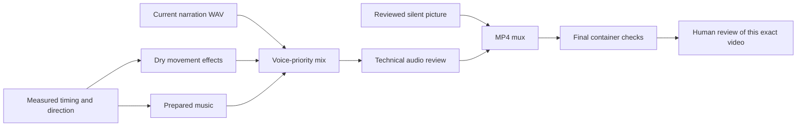

# Effects, quiet music and final graph composition

## What is implemented

All **17 workflow stage slots now have live adapters**. A configured project can run
from research through narration, visual production, effects, music, mixing and final
MP4 checks, then pause at the existing exact-version human review gate. Publishing
is not implemented or performed.

The new `war_workflow/audio.py` connects `effects` and `music_source` and provides one
shared stem-based `mix` implementation for both authored and imported media projects.
It reuses the approved standard-library Foley and music renderers; no new dependency
or sound-generation provider was added. Experimental sound recipes remain isolated.



The mixer reads the current narration, effects and music artifacts. It no longer
rebuilds an older bundle that could contain stale stems or music choices. Existing
independent effects/music CLIs remain available.

## Effects

Effects use the actual measured action timeline and the matching director blueprint.
Existing staggered subgroup Foley is retained. Infantry and cavalry use the established
footstep/hoof defaults. Other moving unit types require an explicit movement profile,
or `none`; no sound is inferred simply from a word in the narration.

Weapon and impact sounds require an explicit timed spot bound to an `engage` action.
Its time is checked against the current measured engagement interval. The production
`battlefield_replay` renderer is now recognized as animated; terrain-only studies and
static geographic callouts continue to omit fictional movement sounds.

Saved outputs include SoundConfig, the exact cue plan, a dry effects WAV, metrics and
snapshotted replacement samples with their attribution. Unresolved profiles stop the
stage and retain its configuration/plan for editing. Replacement audio is validated
before snapshotting. Rendering uses the saved replacement snapshot.

## Music and voice priority

The separate music-source stage prepares the approved original ambient bed or a local
WAV/MP3/OGG/FLAC/M4A/AAC track. It preserves source selection, attribution, source hash,
offset, looping, crossfade settings and prepared-source metadata. Prepared WAV bytes
are copied directly from the verified cache, avoiding a second quantization pass.

Mixing preserves the existing quiet defaults: music gain -22 dB relative to its prepared
reference, smooth fades, additional ducking beneath voice and prominent effects, and
the configured 22 dB voice margin during detected speech. The example quieter edit uses
-28 dB. Narration/effects gains, music enable/disable, timing, fades and ducking are
independently editable. This is signal-based mixing, not a perceptual quality guarantee.

The graph keeps separate narration, dry effects, prepared music, ducked music and final
soundtrack WAVs. It verifies actual stem lengths against the measured clock. Generated
narration must span its exact clock; imported voice excerpts may be shorter and leave
silence after the excerpt. No speech or picture is stretched to force a match.

The technical audio check validates PCM shape, duration and peak headroom. It does not
verify spoken words, pronunciation, historical claims or whether the result is pleasant
to hear. Listening remains part of final human review.

## Editing, caching and recovery

- A mix-volume edit runs mixing, audio checks, muxing and final checks. Picture,
  narration, effects synthesis and music preparation remain reusable.
- A track/source edit prepares the selected music and uses it in the current mix;
  the previous picture and narration are retained.
- A profile edit merges only the supplied profile fields. It preserves other forces,
  samples and existing profile settings. Provide `movement` when creating a profile;
  later edits to that explicit profile may provide just `gain_db`.
- Camera labels and narrative explanations are excluded from the direction's sound
  projection; changing those alone need not regenerate movement Foley.
- Waveform-identical inputs can rebind mix provenance to current artifact IDs without
  running DSP again.

Each audio attempt writes a new output folder. Retries cannot overwrite earlier stem
snapshots. External samples/tracks are hashed in cache identity; their last saved
snapshot remains usable if the original file is moved or removed. A different missing
selection fails explicitly. Relative paths resolve against the project root, except
an imported source retains its original bundle root.

Audio edits currently accept structured settings. Free-text style instructions and
unsupported scene scopes stop with an actionable message. Scoped effects edits use
force IDs and can change only their profiles. This prevents a request from silently
changing unrelated sounds. Profiles remain illustrative Foley, not reconstructed
historical recordings.

Bounded encoder failures now produce a resumable, redacted stage error. Final mux files
use content-hash names, protecting earlier videos and approvals. New edits clear prior
approval; only the current final video can be approved.

## Usage

Use the existing saved-project command after supplying the required terrain mode and
any missing force profiles:

```powershell
& .\.venv\Scripts\python.exe -m war_workflow run PROJECT-PATH --env-file 'E:\AI matirial\content machine\war-tactics-agent\.env'
```

For quieter music without rebuilding the picture or speech:

```powershell
& .\.venv\Scripts\python.exe -m war_workflow edit PROJECT-PATH --parent REVISION-ID --kind music_mix --settings examples/workflow/music-quieter.json
& .\.venv\Scripts\python.exe -m war_workflow run PROJECT-PATH
```

`examples/audio/music-source.json` is the flat MusicSource format for a `music_track`
edit. Change `kind` to `file` and supply a local `path` to select a track. Mix edits use
flat MixSettings fields such as `music_gain_db`, `effects_gain_db` and `enabled`.

`examples/audio/sound-profile.json` is an effects edit template. Replace `FORCE-ID`
with an actual director force ID before use. Accepted movements are `footsteps`,
`heavy_steps`, `hooves`, `tracks`, `wheels` and `none`.

```powershell
& .\.venv\Scripts\python.exe -m war_workflow edit PROJECT-PATH --parent REVISION-ID --kind sound_effect --object FORCE-ID --settings EDITED-PROFILE.json
& .\.venv\Scripts\python.exe -m war_workflow run PROJECT-PATH
```

The resulting `mux` artifact points to the final MP4 with sound. The earlier PixiJS
picture-review bundle remains silent; open the final MP4 to review the composed audio.
After reviewing that exact version:

```powershell
& .\.venv\Scripts\python.exe -m war_workflow approve PROJECT-PATH --revision REVISION-ID
```

This records approval locally. It does not publish remotely.

## Verification

Offline tests cover actual cue generation and WAV mixing, explicit engagement spots,
unresolved units, nested profile edits, replacement-sample validation, source mutation
and loss, music cache integrity, quiet ducking, music disable, stem duration failures,
current artifact provenance and encoder-timeout redaction.

A real LangGraph integration fixture traverses all 17 stages, pauses at human review,
exercises a quieter remix and replaces the track after approval. It verifies that
picture and speech remain unchanged and edits revoke the earlier approval. Providers
and encoded containers are injected in that fixture; its long audio clock uses a
lower supported sample rate for test speed. Production audio uses 48 kHz. This test
does not claim to be a researched historical video.

A separate real DSP/FFmpeg check reused the previously reviewed 24-second movement
video and music source, regenerated effects, added the saved Gemini voice excerpt and
composed the current stems. FFprobe confirmed a **24-second 1080×1920 MP4 with audio**.
It used **zero model, search or TTS requests** and remains **awaiting_review**, with
no human approval or publication. The voice excerpt is a mixing test, not narration
of the illustrative tanks/elephants in that movement study.

- [Real check metadata](../output/audio-final-smoke-result.json)
- [Five-second composition preview](../output/projects/audio-final-smoke-7088a9aa539a48bda467f92020aee0e9/five-second-preview.mp4)

The preview and full MP4 are local ignored outputs. Unconfigured terrain, unchecked
spatial bindings, unknown moving-unit profiles, provider quotas and review failures can
still stop a production run. Automatic GIS/spatial authoring, full-motion/audio semantic
review, an editing UI and publishing remain separate work.

Final verification: **359 Python tests and 20 JavaScript/browser tests pass**, including
17 new audio integration tests. `pip check` reports no broken requirements and patch
whitespace validation passes. The real composition measured music at approximately
-51.3 dBFS RMS and final peak at -1.77 dBFS; those are technical measurements, not a
substitute for listening to the result.
