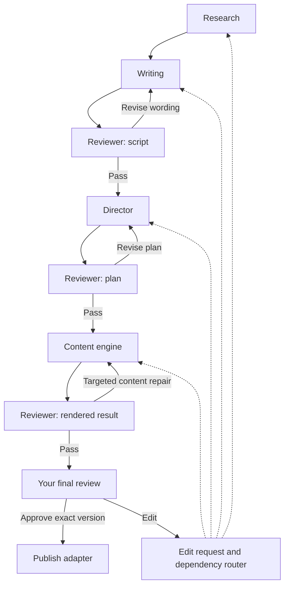
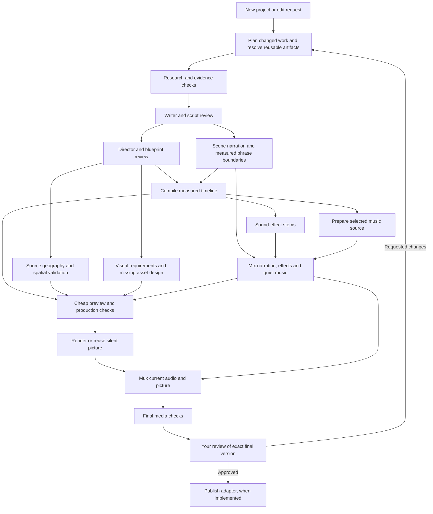

# Proposed LangGraph workflow

Status: the [workflow foundation](WORKFLOW_FOUNDATION_REPORT.md) now implements saved
projects, edit routing, artifact receipts, budgets, real LangGraph checkpointing,
human-review interrupts and live media-edit adapters. The [authoring integration](WORKFLOW_AUTHORING_REPORT.md)
also connects research, writing, script/plan review and direction with bounded repair
loops. [Gemini narration and measured timing](NARRATION_TIMING_REPORT.md) are also live.
[Visual production](VISUAL_PRODUCTION_WORKFLOW_REPORT.md) now connects terrain/unit
design, sampled rendered review and silent export. New-project effects/music preparation,
parallel execution and publishing below remain planned.
Independent CLIs are preserved.

## Main decision

Use a typed, artifact-driven LangGraph workflow with deterministic routing. Models
author research, narration, direction and missing visual assets; ordinary functions
perform dependency planning, timing, caching, media work and routing. A separate
LLM supervisor is unnecessary for those decisions.

Defaults: vertical 9:16, 90–120 seconds, the approved atlas art/movement style,
existing production effects, and very quiet independent music. Experimental sound
recipe generation remains opt-in and outside the production graph.

## High-level graph matching the user's sketch

The user's sketch is the primary organizational model: research -> writing ->
reviewer -> director -> content, with edits entering the stage they concern.
The content stage owns independently editable map, units, animation, narration,
effects, music and composition. It is a subgraph, not one giant generation call.

The reviewer boxes are applications of the same review system to different
artifacts, not three new agents repeating identical checks. Reuse existing valid
reviews. A result-review finding can route to any actual owner, including research
or writing; the drawing's content repair edge is only the common case.

An edit to a content child enters that child directly: map, a specific unit design,
one movement, one sound, narration or music. The router checks the chosen project's
current parents and marks dependent outputs dirty. Entering a stage never means
skipping its input checks or leaving stale downstream output marked current.

These are logical ownership boundaries. The execution DAG below starts narration
as soon as the script passes, while directing proceeds, rather than forcing every
content task to wait for the entire director/content stage.

## Execution dependencies inside that structure

This shows successful dependencies, not every error edge. Each authoring stage
includes its applicable checks. Review failures route to their owner through the
revision planner; only valid outputs proceed. Clean nodes return cached references.
An audio-only edit enters at mixing and bypasses research, narration and picture work.

Narration and direction can overlap after script approval. Geography acquisition,
missing asset creation and narration can overlap when their inputs and quotas permit.
Measured timeline compilation joins the approved blueprint and actual narration.
Sound cues and music preparation follow that timeline, then converge at mixing.
Cheap validation precedes expensive picture encoding. Full-quality export happens
once on a successful first build; audio revisions reuse the picture stream.

## Reviews and repair routing

Reuse current matching script/blueprint/asset reviews instead of adding an identical
model review at every graph boundary. Local validation runs first. Rendered-media
review is an additional distinct check because text review cannot inspect actual
pixels or hear a final mix.

Normalize findings to `owner`, `artifact_version`, `scene_ids`, `object_ids`,
`severity`, `reason`, `required_change` and `attempt_count`:

| Finding | Owner | Reuse |
|---|---|---|
| Missing or conflicting evidence | Research, then dependent scenes | Unaffected evidence and unrelated assets |
| Unsupported wording despite a sufficient dossier | Writer | Research and unrelated assets |
| Unclear narration or poor delivery | Writer or TTS, as appropriate | Research, supported geometry and approved designs |
| Unexplained arrival, impossible route or deployment | Director/spatial adapter | Script/audio if wording remains valid |
| Unrecognizable unit | Asset designer | Terrain, narration and choreography |
| Poor framing or unreadable label | Renderer/director settings | Research, narration and audio stems |
| Harsh effect, loud music or weak ducking | Audio settings or specific sound source | Silent picture and unmodified stems |

An agent does not silently rewrite another owner's artifact. Advisory findings do
not cause automatic loops. Validation failures request a targeted repair. An
unavailable provider is a retry/quota issue, not a reason to rewrite valid content.

## State and saved artifacts

Keep graph state small and serializable:

- Project/revision IDs, request, target format/duration and configuration versions.
- Artifact references: path, exact file hash, semantic cache key, parents, status.
- Dirty scopes, changed scenes/claims/objects and planned work.
- Current review references/findings, budgets and provider availability.
- Final delivery hash and approval/publication receipts.

Store JSON, WAVs, textures and videos in immutable version directories outside graph
state. Use durable local checkpoints initially, plus a small SQLite artifact/job
index for reusable results, reservations and source freshness. SQLite is the local
deployment choice, not a cloud-service requirement. Secrets and large binary payloads
do not belong in checkpoints.

Parallel branches own different state fields; keyed reducer merges reject conflicting
versions of the same artifact. A join checks one consistent revision before compiling
its outputs. A new edit never combines an old script with a new plan accidentally.

## Cache identity and efficient revisions

Use two hashes: an exact artifact hash for provenance/reviews and a semantic content
key for computation reuse. Creation timestamps, call counters and unrelated project
settings must not invalidate expensive work. Cache keys include relevant input content,
configuration, model/voice/style identity and implementation version.

Examples of useful cache units:

- Evidence fetches by canonical source/version and freshness policy.
- Narration by scene text, delivery, voice and applicable pronunciations.
- Terrain by geographic extent, dataset version and projection/style settings.
- Visual design by supported identity, style, actual design version and image review.
- Sound stems by relevant cues, profiles, samples, duration and renderer version.
- Music preparation by source hash, trim/loop settings and required duration.
- Picture by visual timeline, captions, camera, assets, format and renderer version.
- Audio mix by stem hashes and mix controls; final mux by picture/mix hashes.

Existing full-artifact fingerprint checks remain authoritative. A semantic cache hit
cannot simply copy an old reviewed artifact and relabel its hashes. Adapters must
rebuild/validate current provenance and retain only reviews whose reviewed content
and supporting context are still valid.

| User edit | Work to invalidate |
|---|---|
| Music volume/fades | Music mix, final mux, affected QA and final approval |
| Replace music | Music preparation, mix, mux, audio QA and approval |
| Replace one effect | That source/cue stem, mix, mux, audio QA and approval |
| Change a unit silhouette | That asset's review and every frame/scene using it; picture QA and approval |
| Change a route | Relevant spatial plan, movement/frame output and dependent effects cues |
| Change a camera/label style | Relevant picture output and its checks; no narration generation |
| Change one spoken sentence | Its scene narration, timing and affected downstream cues/frames |
| Change a fact | Its cited scenes, forces/terrain/actions and their downstream dependents |
| Change global narrator voice/style | All narration affected by that setting and dependent timing/audio |

Any media edit invalidates final publication approval. Valid research/script/design
reviews may remain reusable. Metadata-only publishing edits affect the delivery
manifest and applicable checks, not necessarily picture/audio generation.

## Scene-level narration and rendering

Generate narration at scene/paragraph granularity to preserve performance and limit
API calls. Measure phrase boundaries in the resulting audio; do not equate estimated
word timing with measured timing. The current `AudioTiming` adds requested pauses
after supplied speech durations. Continuous scene TTS therefore needs a compatible
measured-pause contract/adapter so natural pauses are not counted twice.

A changed scene's duration can shift all later absolute times. Retiming is a cheap
deterministic operation; it does not require rewriting the director's creative plan
when its blueprint still passes. Revalidate speeds, transitions and spatial continuity.

Current picture export is whole-clip. First implement safe reuse of that picture for
audio-only edits. Add scene-chunk rendering afterward, with a cache key covering entry
state, active actions, camera transitions, captions, assets and timing. Earlier movement
changes may invalidate later chunks until their entry states converge. Current gait
also depends on absolute time, so changed offsets cannot be ignored safely. Do not
promise that changing one scene always means rerendering only that scene.

## Quotas, retries and resumability

Start conservatively: one in-flight expensive request per configured provider quota
group, one video encoder, and a small I/O pool. Parallel graph branches express
independence; provider admission control determines actual concurrency. Instantiate
agent/model clients per invocation: existing clients maintain/reset mutable call/use
state and must not be shared unsafely between concurrent branches.

Persist job identities and atomically reserve model/search/TTS budgets before calls.
Graph budgets include agents' local attempts and provider fallbacks; existing HTTP
retry behavior must be accounted for too. Keep current bounded local repairs initially;
do not surround every agent with another blanket retry multiplier.

Allow at most two automatic cross-stage repairs per affected scope and a configurable
global ceiling. Stop with actionable `needs_input`, `quota_wait` or `failed` state
when exhausted. A repeated failure without changed evidence/input must not restart
research or spend another generation budget. Resume the failed work later.

An artifact-producing task writes to a temporary destination, validates it and
publishes a complete immutable manifest. On resume, check that completed receipt
before repeating work. Checkpoints alone do not make external calls exactly-once;
a crash after a provider response but before saving it can still require another
call. Keep operations small and durable to reduce that window.

## Human review and publishing

Default to one required human gate after the actual final media is available.
Earlier storyboard/preview approval can be an optional project setting, rather than
interrupting every successful agent automatically. Missing crucial evidence or
exhausted budgets can also pause with specific issues instead of fake completion.

Bind approval to the exact final video/audio and delivery manifest. Use a checkpointed
LangGraph interrupt for review. Keep publishing in a separate node after approval,
because resumed interrupt nodes can run again from their beginning. Publication
needs a persisted idempotency key/receipt and provider-specific reconciliation;
an uncertain upload must not be blindly repeated.

Publishing is not implemented yet. The first graph should stop at an approved local
deliverable until its platform adapter is supplied and tested.

## Current gaps and implementation order

1. Implement project state, immutable artifact index, change planner and fake-node
   routing tests. Verify music-only and resume scenarios first; no API spending.
2. Wrap existing research/writer/director/content/audio components with cache, budget
   and review adapters. Preserve their independent usage.
3. Build the missing Gemini TTS production/timing adapter, spatial-plan integration,
   source-to-GIS selection and final rendered-media review. The Austerlitz terrain
   study is explicitly a preview, not an existing historical deployment plan.
4. Wire a complete vertical 90–120-second build through preview, export and human
   review. Benchmark real cache hits, model calls, stage latency and revision cost.
5. Add safe scene-chunk rendering and publishing after correctness is established.

Asset requirements are currently planned inside `ContentAgent.build()`, which expects
approved, matching inputs. To create assets while narration is being produced, expose
requirements/checks as a separate adapter using the supported director draft. The
independent unit designer already supplies the reusable design operation. No asset
may enter the final build unless its manifest matches the final validated plan.

Writer/director already contain their reviews and bounded repairs. `retime()` already
reuses a matching blueprint review with no model calls. Existing whole-script/dossier
identity checks constrain partial edits; those adapters must be addressed rather than
bypassed when research or script versions change.

## Required graph tests

Test cache hits without calls; invalidation by edit type; only affected scene TTS;
global voice invalidation; retime and pause accounting; continuity propagation;
parallel joins/reducer conflicts; atomic budget reservation; quota wait/resume;
bounded repeated repairs; crash recovery after saved results; stale review rejection;
approval invalidation after any media edit; publish resume without duplicate upload;
and retaining every stem/source/version during revisions.

This is a proposed design, not tested orchestration code. No runtime tests or model
benchmarks are claimed for the graph itself.

## LangGraph references

Implementation choices were checked against official documentation:

- [Graph API, parallel edges, task results and node cache keys](https://docs.langchain.com/oss/python/langgraph/graph-api).
- [Persistence and checkpoint/store responsibilities](https://docs.langchain.com/oss/python/langgraph/persistence).
- [Interrupts, thread IDs and resume behavior](https://docs.langchain.com/oss/python/langgraph/interrupts).
