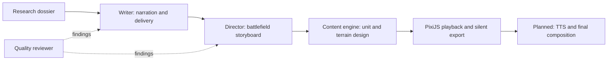

# Agent boundaries and orchestration

The agreed architecture keeps each component runnable through saved, versioned artifacts:

**LangGraph is the chosen coordinator** for connecting agents, maintaining workflow state,
and managing cross-agent review/revision loops and human approval before publishing.
It is Python orchestration, not a replacement for the agents' Python implementation.

The LangGraph coordinator is planned and is **not implemented in this change**. Current
CLIs remain independently usable; their small bounded local retry loops are retained.
When wiring the graph, move cross-agent routing and overall budgets/checkpoints into the
coordinator rather than embedding the full workflow inside one agent.

The graph should carry artifact paths/fingerprints, statuses, review findings and remaining
budgets. It should route unsupported facts back to research, narration issues to writing,
and layout/motion issues to directing. It must not make an agent silently rewrite another
agent's output to satisfy a check. Only changed artifacts and their affected dependencies
should be regenerated. Publishing still requires the user's review.

Research, writing, directing, plan/text review, dynamic unit/terrain design, rendered-asset
review, PixiJS playback and silent MP4 export are implemented. Gemini TTS production,
final rendered-video review, publishing integration and the coordinator remain later components.

Current defaults are Gemini 3.8 Flash with Gemini 3.5 Flash-Lite fallback for research
and writing, and Qwen 3.8 27B through Groq for visuals. Visual appearance is independent
of geographic placement and movement rules. A missing asset is generated as bounded
vector data, rendered, reviewed and cached; it cannot alter the researched event plan.
See [the content engine report](CONTENT_ENGINE_REPORT.md).

The [geography stage](GEOGRAPHY_ENGINE_REPORT.md) now compiles source GeoJSON and
elevation tiles into coastlines and relief, independently of LLM asset design.
The geographic renderer bypasses unlocated schematic terrain/routes; historical
place callouts carry source references. The Falklands example and custom-region
inputs work now. Automatic topic-to-GIS selection remains an upstream integration task.

Battlefield views have a separate tilted-heightfield renderer and an Austerlitz
[terrain study](BATTLEFIELD_TERRAIN_REPORT.md). Campaign maps retain their overview
layout. The study is explicitly non-publishable; historically located formations,
crossings and movement corridors still require a checked spatial director plan.
