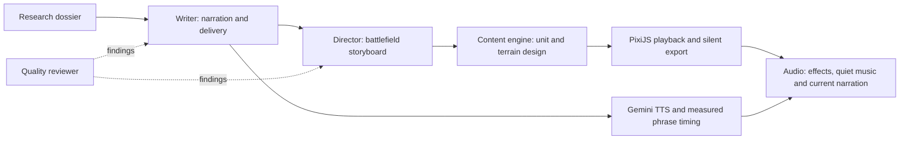

# Agent boundaries and orchestration

The agreed architecture keeps each component runnable through saved, versioned artifacts:

The detailed [LangGraph workflow proposal](LANGGRAPH_WORKFLOW_PLAN.md) describes
parallel dependencies, targeted revisions, cache boundaries, review routing and
implementation gaps. The [first coordinator foundation](WORKFLOW_FOUNDATION_REPORT.md)
implements saved projects, edit routing, checkpointing and media-only revisions.
The [authoring integration](WORKFLOW_AUTHORING_REPORT.md) connects research, writing,
script review, direction and plan review, with bounded owner-directed repair loops.
Its high-level structure follows the user's sketch: research -> writing -> review
-> director -> content, with edit entry points at each stage and separate content
children for map, units, movement and audio. Review is reused at later checkpoints.

**LangGraph is the chosen coordinator** for connecting agents, maintaining workflow state,
and managing cross-agent review/revision loops and human approval before publishing.
It is Python orchestration, not a replacement for the agents' Python implementation.

The LangGraph foundation and text/plan authoring adapters are implemented.
Current CLIs remain independently usable; their small bounded local retry loops are retained.
The coordinator owns cross-agent repair routing, overall budget reservations and
checkpoints. Each failed text/plan review allows one repair cycle by its owner;
unresolved failures stop for edits.

The graph should carry artifact paths/fingerprints, statuses, review findings and remaining
budgets. It should route unsupported facts back to research, narration issues to writing,
and layout/motion issues to directing. It must not make an agent silently rewrite another
agent's output to satisfy a check. Only changed artifacts and their affected dependencies
should be regenerated. Publishing still requires the user's review.

Research, writing, directing, plan/text review, dynamic unit/terrain design, rendered-asset
review, PixiJS playback and silent MP4 export are implemented. [Gemini TTS and measured
timing](NARRATION_TIMING_REPORT.md) are now connected. [Visual production adapters](VISUAL_PRODUCTION_WORKFLOW_REPORT.md)
connect independent terrain/unit design, sampled frame review and silent picture export.
[Effects, music preparation and current-stem composition](AUDIO_WORKFLOW_REPORT.md)
connect all 17 stage slots through final human review. Full rendered-video semantic
review, automated spatial authoring and publishing integration remain later components.

Current defaults are Gemini 3.8 Flash with Gemini 3.5 Flash-Lite fallback for research
and writing, and Qwen 3.8 27B through Groq for visuals. Visual appearance is independent
of geographic placement and movement rules. A missing asset is generated as bounded
vector data, rendered, reviewed and cached; it cannot alter the researched event plan.
See [the content engine report](CONTENT_ENGINE_REPORT.md).

The [geography stage](GEOGRAPHY_ENGINE_REPORT.md) now compiles source GeoJSON and
elevation tiles into coastlines and relief, independently of LLM asset design.
The geographic renderer bypasses unlocated schematic terrain/routes; historical
place callouts carry source references. The Falklands example and custom-region
inputs work now. Automatic topic-to-GIS selection remains an upstream integration task.

Battlefield views have a separate tilted-heightfield renderer and an Austerlitz
[terrain study](BATTLEFIELD_TERRAIN_REPORT.md). Campaign maps retain their overview
layout. The study is explicitly non-publishable; historically located formations,
crossings and movement corridors still require a checked spatial director plan.

The independent [unit designer](UNIT_DESIGN_REPORT.md) now shares its generation,
rendered review, repair and cache path with production content builds. New unit
identities use descriptive briefs, without requiring new renderer code. Symbol
dimensions are normalized by actual geometry for consistent phone-screen readability.

The shared [unit animation layer](UNIT_ANIMATION_REPORT.md) evaluates independent
subgroup movement deterministically. A separate offline study demonstrates it on
the battlefield surface with illustrative, non-publishable deployments.

The independent [sound-effects stage](SOUND_EFFECTS_REPORT.md) consumes the saved
timeline and explicit unit sound profiles. It produces editable cue data, effects
and narration stems, a ducked mix, and a sound-enabled bundle. Audio drives preview
playback timing; the exporter includes its verified soundtrack. Music is separate.

The [music/mix stage](MUSIC_REPORT.md) adds a quiet independent music source, cached
preparation and an editable audio-project manifest. It retains original/dry stems,
source hashes, mix controls and parent versions; effects revisions preserve music.
Audio-only edits can stream-copy a matching video instead of rerendering frames.
