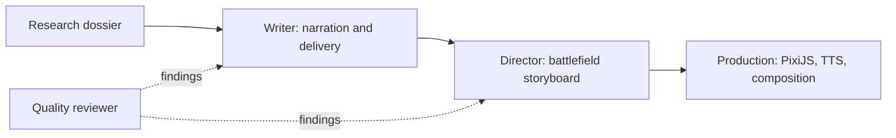

# Agent boundaries and orchestration

The agreed architecture keeps each component runnable through saved, versioned artifacts:

**LangGraph is the chosen coordinator** for connecting agents, maintaining workflow state,
and managing cross-agent review/revision loops and human approval before publishing.
It is Python orchestration, not a replacement for the agents' Python implementation.

The LangGraph coordinator is planned and is **not implemented in this change**. Current
CLIs remain independently usable; their small bounded local retry loops are retained.
When wiring the graph, move cross-agent routing and overall budgets/checkpoints into the
coordinator rather than embedding the full workflow inside one agent.

The graph should carry artifact paths/fingerprints, statuses, review findings and remaining
budgets. It should route unsupported facts back to research, narration issues to writing,
and layout/motion issues to directing. It must not make an agent silently rewrite another
agent's output to satisfy a check. Only changed artifacts and their affected dependencies
should be regenerated. Publishing still requires the user's review.

Research, writing, directing, and plan/text review are implemented. Actual PixiJS rendering,
Gemini TTS production, final rendered-media review, and the coordinator are later components.
