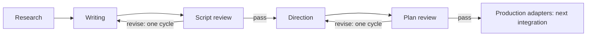

# Workflow authoring integration

Follow-up: [narration and measured timing](NARRATION_TIMING_REPORT.md) are now connected.
The scope and test counts below describe the earlier authoring milestone.

## Purpose and scope

The saved-project graph now runs the existing research, writer, reviewer and director
agents through five live stage adapters: `research`, `writing`, `script_review`,
`direction` and `plan_review`. The independent agent CLIs and saved Pydantic contracts
remain usable. This integration does not replace their evidence, timing or route checks.

The default model route remains the repository's stronger Gemini route with its Lite
fallback. Model selection was not changed or benchmarked in this step.

## Execution and saved outputs

The authoring path is:



`war_workflow/authoring.py` supplies small wrappers around the existing APIs. Each
completed stage produces its original typed contract as JSON, plus the workflow
manifest and receipt. Filenames include content hashes, so reruns do not overwrite
earlier contracts. The writer also exports `tts_plan` with phrase IDs, spoken text,
voice/tone instructions, emphasis, pronunciation hints and target pauses.

The graph finishes connected independent branches before stopping at an unavailable
adapter. A fresh project can therefore complete plan review even while narration is
not connected. It then stops explicitly at `narration`; it has not made or approved a
new narrated video. Existing music-only projects continue using their media adapters.

## Quality and repair routing

The agents retain their existing local validation, review and bounded repair attempts.
The graph adds separate reviewer-role calls for the script and plan. These consume
the same overall model budget. A separate role using the same configured model is
not independent historical verification, visual inspection or audio listening.

A failed graph review is saved as a draft and routed to its owning stage: script
findings go to writing; plan findings go to direction. Feedback enters that owner's
request and cache key. There is at most **one graph repair cycle per review stage per
revision**, persisted across restarts. A second failure stops with `needs_input`.
Independent agents may themselves make multiple bounded calls during that cycle.

Incomplete research or failed authoring checks retain their draft and stop downstream
work. The graph does not automatically spend more searches to fill historical gaps,
or let a reviewer silently rewrite another agent's contract. User edits create a new
revision with fresh repair allowances and budget counters.

## Budget accounting and recovery

Model wrappers reserve a project `model_attempts` unit before each provider attempt,
including a fallback. Web wrappers reserve `search_requests` before each uncached
search, Wikipedia lookup or extraction batch. An extraction batch is one operation;
the research agent separately bounds its URL count. Internal HTTP transport retries
are within a logical provider operation and are not separately counted by this layer.
These counters cap work; they do not guarantee that a provider request is free.

The existing web cache is shared within a project. Saved discovery has its own
integrity-checked receipt, so exhaustion between topic selection and dossier generation
can resume without selecting again. The research cutoff defaults to the revision's
creation date, keeping same-revision retries consistent.

`quota_wait` remains resumable. To increase a local revision's allowance deliberately:

```python
from war_workflow.store import ProjectStore
store = ProjectStore("PROJECT-PATH")
store.set_limit(store.load().id, "model_attempts", 40)
```

Then rerun the same revision. Reservations already made are retained, including
failed attempts; interruption cannot silently refund them. Provider factories are
lazy: completed work and media-only edits do not initialize Gemini or Tavily clients.

## Edit scope, cache reuse and provenance

Research edits replace the dossier through the research adapter. Script and route
edits can target one stable scene ID; the independent writer/director preserve other
scenes. Multiple scene IDs and object-only authoring edits stop explicitly because
these APIs currently accept a single scene or full artifact. Unknown settings fail
schema validation before a model request.

A targeted script edit requires the previous script to reference the current dossier.
A targeted director edit requires the previous plan to reference the current dossier
and script. If an upstream contract changed, request a full rewrite/plan first.

Semantic views separate speech, phrases, captions, terrain, units and actions. Research
views conservatively retain the evidence and editorial context, excluding only top-level
run metadata. Cached scripts/plans are rebound to current input fingerprints and
validated before reuse. A review of an earlier contract cannot qualify a different
current contract. This favors conservative reuse over silently carrying stale citations.

## Usage

Install the optional workflow dependencies in the workspace environment, then:

```powershell
& .\.venv\Scripts\python.exe -m war_workflow init --topic 'Battle of Austerlitz'
& .\.venv\Scripts\python.exe -m war_workflow run PROJECT-PATH --env-file 'E:\AI matirial\content machine\war-tactics-agent\.env'
& .\.venv\Scripts\python.exe -m war_workflow status PROJECT-PATH
& .\.venv\Scripts\python.exe -m war_workflow edit PROJECT-PATH --parent REVISION-ID --kind script --scene s1 --notes 'Make the hook more direct while preserving uncertainty.'
& .\.venv\Scripts\python.exe -m war_workflow run PROJECT-PATH --env-file 'E:\AI matirial\content machine\war-tactics-agent\.env'
```

The environment file is read only at runtime; keys are not written into project state
or reports. Existing process environment values take precedence. `GEMINI_MODEL` can
override the existing model route without changing this integration's code.

Inspect contracts under `work/REVISION/STAGE/`, review findings in their saved JSON,
and state/budgets with `status`. A failed run returns CLI exit code 2 for an actionable
stop such as `needs_input` or `quota_wait`. Final approval still requires an exact video
and the graph's human-review interrupt; authoring completion cannot approve publishing.

## Verification and limits

**298 Python tests and 20 JavaScript/browser tests pass**, including 20 new authoring
integration tests. `pip check` reports no broken requirements; patch whitespace
validation passes.

The new offline integration tests execute the real independent agents and real
LangGraph runner using synthetic web evidence and schema-specific model responses.
They cover the five-stage path, persistent resume, separate review gates, both repair
routes, repair limits, failed drafts, incomplete research, quota reservation, fallback
attempts, discovery/web-cache recovery, scene preservation, stale provenance, unsupported
edit scopes, current-version cache rebinding, lazy clients, CLI wiring and TTS handoff.
An action-only plan change also preserves the terrain and unit semantic views for reuse.

No live API calls were made and no real historical research/video is claimed from these
synthetic fixtures. TTS generation/alignment, geography/assets/timing production adapters,
rendered video review and publishing remain later integrations. Scheduling remains serial;
provider-wide rate limiting and automatic cross-provider quota recovery are not implemented.
